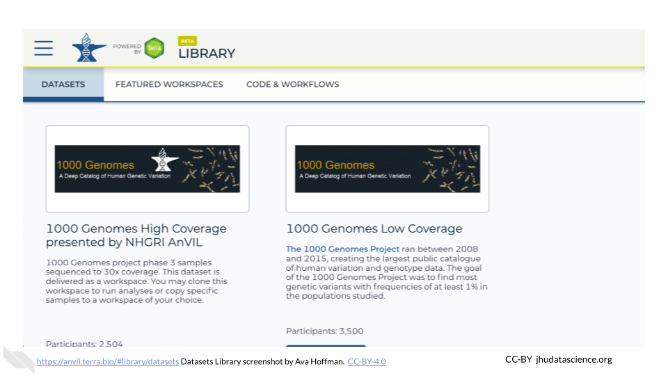

# From a Workspace {#downloading-workspace}

AnVIL Workspaces have multiple ways for you to download your data. 

For this example, we are using a workspace that has fasta files saved in the workspace bucket.

::: {.notice}
_Genetics_

**Novice**: no genetics skills needed

_Programming skills_

**Beginner**: some comfort with [workflows and WDLs](https://jhudatascience.org/AnVIL_Book_Getting_Started/workflows.html) may be needed
:::

::: {.notice}
**What will this cost?**
Data egress (that is, moving data outside of a storage bucket) has costs associated with it. Most AnVIL Buckets are all set as "Requester Pays", so you will incur the cost of moving the data.

:::

## Downloading from the Files tab

## Downloading from the Google bucket

## Downloading using the command line

